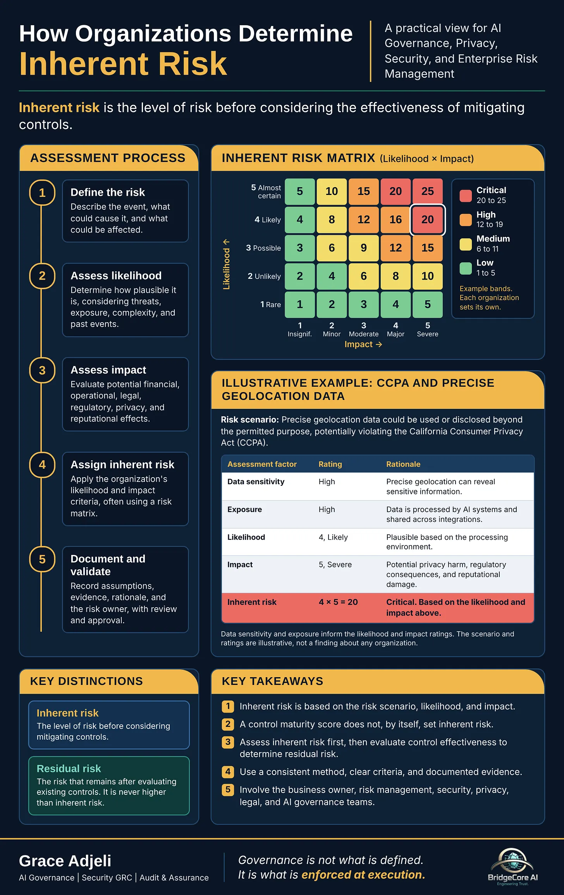

# Residual Risk Case: Testing Whether the Control Works

I built this repo to show one thing. A risk register can say "Medium" while the real exposure is still "Critical," because the number came from whether a control exists, not from evidence that it works.

In my AI governance work, I often see residual risk rated from a control's documentation or maturity. A control can be approved, documented and well run, and still fail against the exact misuse the risk describes. When that happens, nobody can say what the rating rests on.

So I took one agentic AI scenario, an AI agent reading precise geolocation data for a purpose the user never consented to, and did what I think the rating should require. I rated the inherent risk (20, Critical), tested the control for design, implementation and operation, and computed the residual risk from the results. If the tests pass with current evidence, it drops to 10 (Medium). If the control is untested, failing or stale, it stays at 20.

The ratings are illustrative. The method and the tests are real.


## What the repo shows

| Configuration | Allowed | Blocked | Leaks |
|---|---|---|---|
| Purpose gate | 3 | 29 | 0 |
| Defective fixture (checks consent exists, not purpose) | 16 | 16 | 13 |
| No control | 32 | 0 | 29 |

A leak is a read that was allowed although it should have been refused. The defective fixture looks like a control and passes a review that only asks whether one exists, yet it lets 13 of 32 requests through. Only testing against misuse shows the difference.

## Run it
```
pip install pytest
python scripts/run_evidence.py --tester "Your Name"
```
Writes `evidence/evidence-<timestamp>.json`: what was tested, when, by whom, under what conditions (commit, platform, data, clock), per-test results, and the rating outcome.

## From scenario to decision

| Step | Where |
|---|---|
| 1 Risk scenario | `risk_register/geo-001.json` |
| 2 Inherent risk: Likelihood 4 x Impact 5 = 20 (Critical) | `risk_register/geo-001.json`, `src/rating.py` |
| 3 Relevant control: purpose limitation gate (preventive) | `src/purpose_gate.py` |
| 4 Test effectiveness: design, implementation, operation | `tests/test_control.py` |
| 5 Residual risk, computed from the evidence | `scripts/run_evidence.py`, `src/rating.py` |
| 6 Owner decision | Recorded by the risk owner against `tolerance` in the register |
| 7 Reassess on triggers | `reassess_on` in the register; CI reruns on every push and monthly |

## Reduction rule (a recorded judgment, not a derived value)
Likelihood drops 2 levels (floor 1) only if design, implementation and operation tests all pass and the evidence is under 90 days old. Otherwise residual equals inherent.

- Tests pass: 4 x 5 = 20 becomes 2 x 5 = 10 (Medium)
- Untested, failed or stale evidence: stays 20 (Critical)

## Simulation
`python -m src.simulate` runs a fixed stream of 32 synthetic requests (8 purposes x 4 consent states) three ways; results are in the table above.

Each run writes a hash-chained decision log; altering one entry breaks verification. `sim/index.html` is a separate browser illustration of the same idea. It does not call the Python code and keeps everything in page memory. The defective fixture is an educational example, not a real incident.

## Evidence record
`scripts/run_evidence.py` writes `evidence/evidence-<timestamp>.json` plus a `.manifest.json` holding its SHA256, and records commit, CI run id and attempt, Python version, test results by dimension, the simulation results, and the rating outcome. CI runs on Python 3.10 and 3.12.

## Recovery after a defective control

A control claim should not stay valid because it once passed. `src/recovery.py` records what happens when it fails and how it is restored, in four steps:

1. **Invalidated.** The defective fixture leaks (13 of 32 requests), so the claim "residual risk is 10 (Medium)" is invalidated and bound to the SHA256 of the defective source.
2. **Corrected, pending retest.** The corrected source is recorded with its own SHA256 and must differ from the defective one.
3. **Pending review.** The same 32-request stream and the same corrected version are retested, and the regression suite must pass. A different version, a different condition, a failed regression or a new failure stops it.
4. **Restored, bounded.** A designated reviewer restores only the recorded claim. Restoration does not authorize any future read; each read still needs its own gate decision.

`python scripts/run_recovery.py` runs the sequence and writes a hash-chained ledger (`evidence/recovery-<timestamp>.json`) with a SHA256 manifest. The reviewer is a simulated role name, not an authenticated identity.

## Negative check
Weakening the gate (removing the permitted-purpose check) makes the operation tests fail and the residual stays 20. The recovery tests also cover premature restoration, a wrong reviewer, a wrong version, a wrong condition and a new failure. The rating cannot improve without passing evidence.

## Limits
The simulation covers scenarios written for this gate; it does not measure how often real misuse occurs, so it supports the effectiveness rating but cannot set likelihood. Single process, synthetic data, trusted inputs (purpose, consent, clock), in-memory logs, and no independent assurance. The gate checks the purpose it is given; it does not show that an agent states its purpose truthfully. In a real system the orchestrator, not the model, should set the purpose.

Ratings are illustrative. Synthetic data only. Tests show this gate behaves as specified; they do not prove no other code path reads the data. The risk owner decides treat, monitor or accept.

## Related

- Case study page: [Engineering AI Governance: From Inherent Risk to Residual Risk](https://bridgecore-ai.com/ai-governance-residual-risk.html), a practitioner write-up of this repo with an interactive example, published on the BridgeCore AI website. The same page is kept in this repo as [docs/case-study.html](docs/case-study.html) (GitHub shows the source; open it in a browser to read it).
- Article: From Inherent Risk to Residual Risk (Governance at Execution, Substack and LinkedIn).
- Part 1 of the series, how organizations determine inherent risk, which is where the starting rating of 20 comes from:



## Rights

Code is released under the MIT license (see LICENSE). The images in `docs/` are © BridgeCore AI LLC, all rights reserved.
